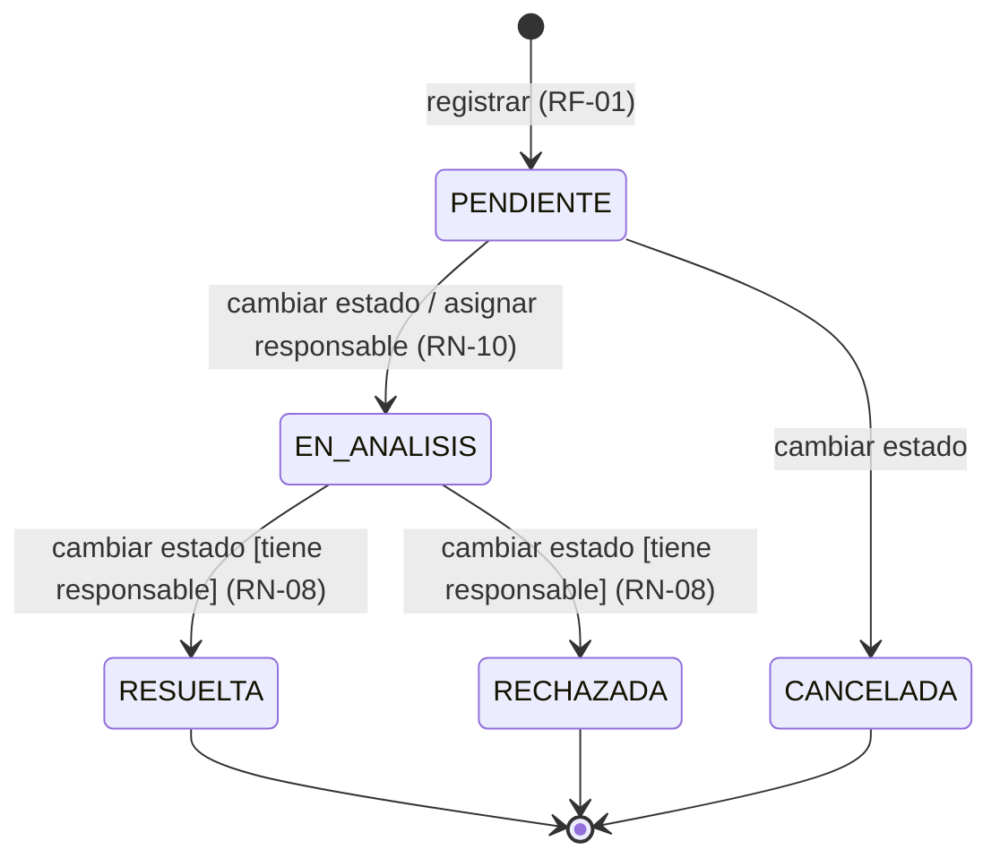
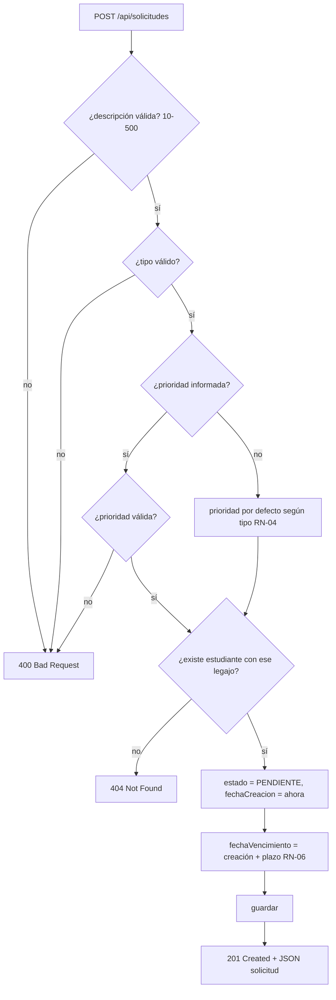
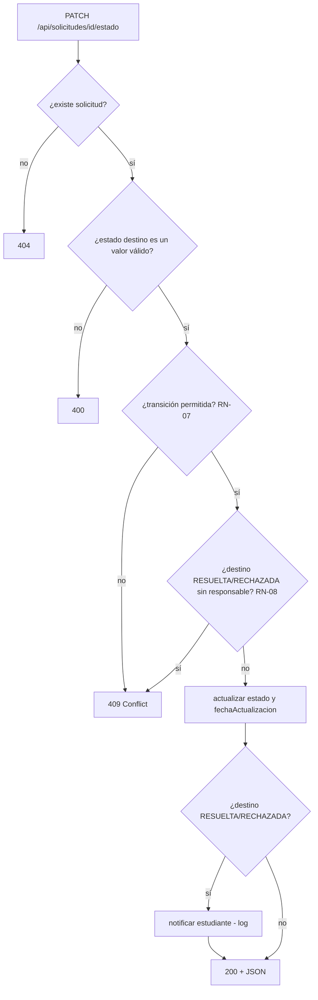
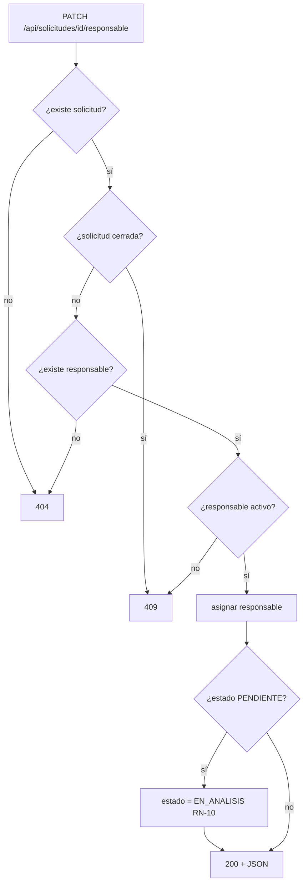

# 03 — Flujos

## 1. Máquina de estados de una solicitud

Estados cerrados: `RESUELTA`, `RECHAZADA`, `CANCELADA`.

## 2. Flujo: registrar solicitud (RF-01)

> **Orden de validación (importante, forma parte del contrato):** descripción → tipo → prioridad → legajo. v1 y v2 deben validar en el mismo orden para devolver el mismo error ante una entrada con varios problemas.

## 3. Flujo: cambiar estado (RF-04)

## 4. Flujo: asignar responsable (RF-05)

## 5. Flujo: reporte resumen (RF-06)

1. Obtener todas las solicitudes.
2. Contar por estado: incluir **todos** los estados, con 0 si no hay solicitudes.
3. Contar por tipo: incluir **todos** los tipos, con 0 si no hay solicitudes.
4. Contar vencidas (RN-11).
5. Devolver `200` con `{ total, porEstado, porTipo, vencidas }`.

## 6. Flujo de trabajo del TPI (proceso, no sistema)

```mermaid
flowchart LR
    V1[v1 con deuda] -->|tag estado-inicial| T[tests de caracterización<br/>verdes en v1]
    T --> DX[diagnóstico: 8+ smells<br/>+ PMD antes]
    DX -->|tag etapa-diagnostico| RF[refactorings R01..R08<br/>1 commit c/u, tests verdes]
    RF --> PR[Pull Request + code review<br/>con checklist]
    PR -->|merge, tag etapa-refactoring| PT[tests unitarios nuevos<br/>+ JaCoCo/PMD después]
    PT -->|tag etapa-pruebas| DOC[README + docs TPI]
    DOC -->|tag etapa-docs| FIN[tag estado-refactorizado]
```

