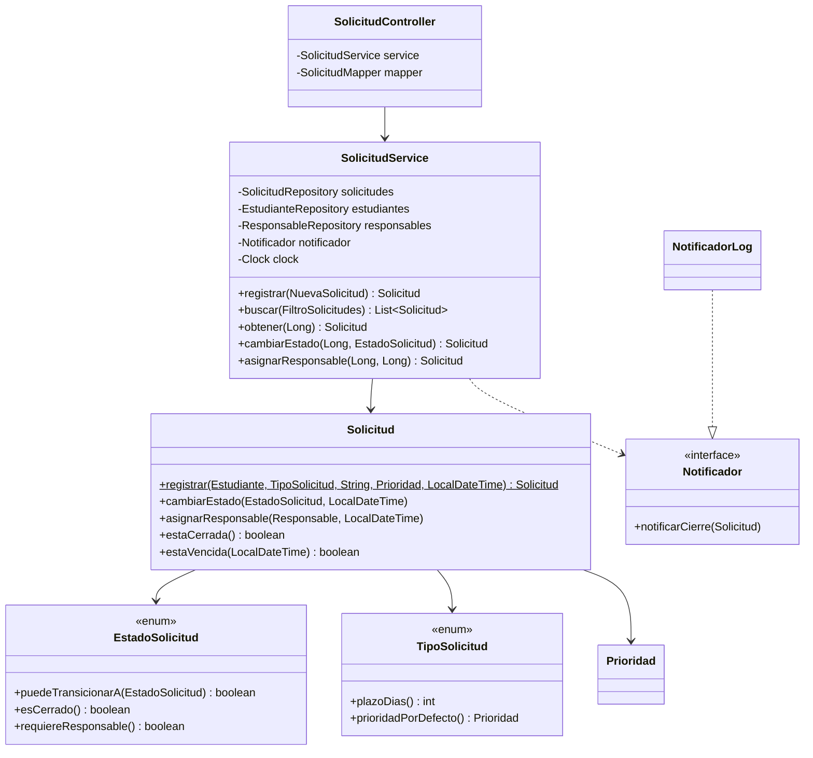

# 04 — Diseño: v1 (con deuda) → v2 (refactorizado)

## 1. Diseño v1 — "hecho con apuro"

Arquitectura: **controlador gordo directo a repositorios**, sin capa de servicio, con entidades anémicas.

```
ar.edu.utn.tup.solicitudes
├── SolicitudesApplication.java
├── model/
│   ├── Solicitud.java        (entidad JPA; estado/tipo/prioridad como String)
│   ├── Estudiante.java
│   └── Responsable.java
├── repository/
│   ├── SolicitudRepository.java
│   ├── EstudianteRepository.java
│   └── ResponsableRepository.java
├── controller/
│   ├── SolicitudController.java   (≈ 300-400 líneas: TODO pasa acá)
│   └── SoporteController.java     (estudiantes y responsables)
└── util/
    ├── Utils.java                 (métodos static: validaciones, plazos, fechas)
    └── NotificadorConsola.java    (System.out.println)
```

### 1.1 Cómo construir la v1 (instrucciones precisas para Claude Code)

- **`SolicitudController`** maneja **todos** los endpoints de solicitudes **y** el reporte (`/api/reportes/resumen`). Usa `@Autowired` en campos para los tres repositorios.
- Los `@RequestBody` llegan como **`Map<String, Object>`** y se leen con casteos (`(String) body.get("tipo")`).
- Las respuestas se arman a mano como **`Map<String, Object>`** (con `LinkedHashMap`), **copiando y pegando** el mismo bloque de mapeo en cada endpoint (crear, obtener, listar, cambiar estado, asignar responsable). El JSON tiene que respetar exactamente el contrato de `05-esquema-backend.md` §5.
- **`crear(...)`** es un método largo (unas 60-80 líneas) que hace en línea: lectura del Map, validación de descripción con literales `10` y `500`, validación de tipo con una cadena de `equals`, prioridad por defecto con un `if/else` sobre el tipo, búsqueda del estudiante, cálculo del vencimiento llamando a `Utils.calcularDias(tipo)` (un `switch` sobre String) y ajuste por prioridad `ALTA` con `if` en línea, armado de la entidad mediante un método privado con **7 parámetros** `armarSolicitud(String legajo, String tipo, String descripcion, String prioridad, LocalDateTime creacion, int dias, Estudiante est)`, guardado y mapeo.
- La **prioridad por defecto** y el **plazo** se deciden con **dos `switch`/`if` paralelos sobre el mismo String `tipo`**, uno en el controller y otro en `Utils`.
- La regla de transición de estados está en un método privado del controller, **`puedeCambiar(Solicitud s, String nuevo)`**, que solo usa datos de la solicitud (feature envy), implementado con `if` anidados y strings literales.
- El chequeo de "solicitud cerrada" (`s.getEstado().equals("RESUELTA") || ... "RECHAZADA" || ... "CANCELADA"`) aparece **copiado en al menos 3 lugares** (cambiar estado, asignar responsable, reporte de vencidas).
- **Manejo de errores**: cada endpoint envuelve todo en `try { ... } catch (Exception e)`. Los errores de negocio se lanzan como `new RuntimeException("404|Estudiante no encontrado: " + legajo)` y en el `catch` se **parsea el prefijo del mensaje** (`404|`, `409|`, `400|`) para decidir el código HTTP. El cuerpo del error es **texto plano**: `"Error: " + mensaje`.
- La **búsqueda con filtros** hace `findAll()` y filtra en memoria con 4 `if` anidados dentro de un `for`, con variables `lista`, `lista2`, `aux`.
- El **reporte** es un método largo que recorre la lista varias veces, usa `HashMap` inicializados a mano con cada estado y cada tipo como literales, y repite el chequeo de "cerrada".
- La **hora actual** se obtiene con `LocalDateTime.now()` en varios lugares (dependencia oculta, no testeable).
- La **notificación** se hace con `new NotificadorConsola().notificar(...)` dentro del controller, que hace `System.out.println`.
- **Nombres pobres**: `s`, `e`, `est`, `aux`, `lista2`, `procesar`, `dato`, `res`.
- Queda **código comentado** de una versión vieja del cálculo de vencimiento y un par de `System.out.println("DEBUG ...")`.
- `SoporteController` repite el mapeo manual de `Estudiante` y `Responsable` a `Map`.
- Las entidades tienen solo getters/setters y un constructor vacío (**modelo anémico**).

> **Importante:** la v1 debe compilar, funcionar y pasar los 15 tests de caracterización. Sin comentarios que "confiesen" los smells.

## 2. Catálogo de smells a introducir en v1 y diagnosticar

| ID | Smell (nombre de catálogo) | Dónde aparece en v1 | Impacto | Riesgo | Prioridad |
|---|---|---|---|---|---|
| S01 | **God Class / Large Class** | `SolicitudController` | Cualquier cambio toca la misma clase; conflictos de merge; difícil de entender. | Alto | Alta |
| S02 | **Long Method** | `SolicitudController.crear()`, `reporte()`, `listar()` | Difícil de leer, probar y modificar; mezcla niveles de abstracción. | Alto | Alta |
| S03 | **Duplicated Code** | Mapeo Solicitud→Map en 5 endpoints; chequeo "cerrada" en 3 lugares; mapeo en `SoporteController` | Un cambio de campo JSON obliga a editar 5 lugares; fácil olvidarse uno. | Alto | Alta |
| S04 | **Primitive Obsession / Magic Strings** | `estado`, `tipo`, `prioridad` como `String`; `"PENDIENTE"`, `"ALTA"` como literales | Errores de tipeo silenciosos; el compilador no ayuda. | Alto | Alta |
| S05 | **Long Parameter List** + **Data Clumps** | `armarSolicitud(7 params)`; `Utils.validar(descripcion, tipo, prioridad, legajo)`; `Map<String,Object>` como body | Llamadas confusas; orden de parámetros propenso a errores. | Medio | Media |
| S06 | **Feature Envy** | `SolicitudController.puedeCambiar(Solicitud, String)` | La regla de estados vive lejos de los datos que usa. | Medio | Alta |
| S07 | **Switch Statements repetidos** (violación de OCP) | `switch(tipo)` en `Utils.calcularDias` + `if/else(tipo)` de prioridad en el controller | Agregar un tipo obliga a modificar varios `switch`. | Medio | Media |
| S08 | **Anemic Domain Model** | `model/Solicitud` solo getters/setters | Las reglas de negocio están dispersas; la entidad puede quedar inconsistente. | Medio | Media |
| S09 | **Nombres poco expresivos + Magic Numbers** | `s`, `aux`, `lista2`, `procesar`; `10`, `500`, `2`, `15` | Hay que leer el cuerpo entero para entender la intención. | Bajo | Media |
| S10 | **Manejo de errores deficiente** (catch genérico + códigos en strings) | `catch (Exception e)` + parseo de `"404|..."` | Oculta bugs, acopla el HTTP a texto libre, respuesta de error inconsistente. | Alto | Alta |
| S11 | **Acoplamiento fuerte / violación de DIP** | `new NotificadorConsola()`, `LocalDateTime.now()`, `Utils` static, `@Autowired` en campos | No se puede testear ni reemplazar la notificación o el reloj. | Medio | Media |
| S12 | **Dead Code / Comentarios / System.out** | Bloque comentado del cálculo viejo; `System.out.println("DEBUG")` | Ruido; confusión sobre qué código es el vigente. | Bajo | Baja |

## 3. Diseño v2 — refactorizado

Arquitectura en capas con **dominio rico**:

```
ar.edu.utn.tup.solicitudes
├── SolicitudesApplication.java
├── config/
│   └── ClockConfig.java                 (@Bean Clock)
├── dominio/
│   ├── Solicitud.java                   (entidad con comportamiento)
│   ├── Estudiante.java
│   ├── Responsable.java
│   ├── EstadoSolicitud.java             (enum: puedeTransicionarA, esCerrado, requiereResponsable)
│   ├── TipoSolicitud.java               (enum: plazoDias, prioridadPorDefecto, desde(String))
│   ├── Prioridad.java                   (enum: ajustarPlazo, desde(String))
│   └── excepciones/
│       ├── RecursoNoEncontradoException.java   → 404
│       ├── ReglaDeNegocioException.java        → 409
│       └── DatoInvalidoException.java          → 400
├── aplicacion/
│   ├── SolicitudService.java            (casos de uso RF-01..RF-05)
│   ├── ReporteService.java              (RF-06)
│   ├── NuevaSolicitud.java              (record — Parameter Object)
│   ├── FiltroSolicitudes.java           (record — Parameter Object + coincideCon(Solicitud))
│   ├── Notificador.java                 (interface — DIP)
│   └── NotificadorLog.java              (implementación con SLF4J)
├── persistencia/
│   ├── SolicitudRepository.java
│   ├── EstudianteRepository.java
│   └── ResponsableRepository.java
└── web/
    ├── SolicitudController.java         (fino: recibe, delega, responde)
    ├── ReporteController.java
    ├── SoporteController.java
    ├── SolicitudMapper.java             (único lugar de mapeo dominio→DTO)
    ├── ManejadorGlobalErrores.java      (@RestControllerAdvice)
    └── dto/
        ├── RegistrarSolicitudRequest.java   (record; sin Bean Validation, ver ADR-005)
        ├── CambiarEstadoRequest.java
        ├── AsignarResponsableRequest.java
        ├── SolicitudResponse.java
        ├── ReporteResumenResponse.java
        ├── EstudianteResponse.java
        ├── ResponsableResponse.java
        └── ErrorResponse.java
```

### 3.1 Diagrama de clases v2 (núcleo)



## 4. Refactorings planificados (mínimo exigido: 4)

Orden pensado para que **cada paso sea chico y los tests sigan en verde**.

| ID | Técnica (catálogo Fowler) | Smell que resuelve | Principio | Descripción |
|---|---|---|---|---|
| **R01** | **Extract Method** ⭐ obligatorio | S02, S03 | Clean Code: funciones chicas, un nivel de abstracción | Partir `crear()` en `validarDescripcion`, `resolverPrioridad`, `calcularVencimiento`; extraer `aMap(Solicitud)` y `estaCerrada(Solicitud)` para eliminar duplicación. Todavía dentro del controller. |
| **R02** | **Replace Type Code with Enum** (Replace Primitive with Object) | S04 | Clean Code / tipado | Crear `EstadoSolicitud`, `TipoSolicitud`, `Prioridad`; `@Enumerated(EnumType.STRING)` para que la base y el JSON no cambien. |
| **R03** | **Move Method** ⭐ obligatorio | S06, S08 | Cohesión, Tell-Don't-Ask | Mover `puedeCambiar` → `EstadoSolicitud.puedeTransicionarA`; mover `estaCerrada` → `EstadoSolicitud.esCerrado` / `Solicitud.estaCerrada`; la entidad gana `cambiarEstado()` y `asignarResponsable()`. |
| **R04** | **Replace Conditional with Polymorphism** (lógica dentro del enum) | S07 | **OCP** | `TipoSolicitud` conoce su `plazoDias()` y `prioridadPorDefecto()`; desaparecen los `switch` sobre el tipo. Agregar un tipo = agregar una constante. |
| **R05** | **Introduce Parameter Object** ⭐ obligatorio | S05 | Clean Code: pocos parámetros | `RegistrarSolicitudRequest` (record) reemplaza al `Map<String,Object>`; `NuevaSolicitud` reemplaza a `armarSolicitud(7 params)`; `FiltroSolicitudes` agrupa los 4 filtros de búsqueda. |
| **R06** | **Extract Class** (reubicación de responsabilidades) | S01 | **SRP** | Sacar del controller: `SolicitudService`, `ReporteService`, `SolicitudMapper`, `ReporteController`. |
| **R07** | **Replace Error Code with Exception** + manejo centralizado | S10 | Clean Code: manejo de errores | Excepciones propias + `ManejadorGlobalErrores`; sin `catch (Exception)` ni prefijos `"404|"`. El cuerpo de error pasa a `ErrorResponse` JSON (único cambio externo, intencional y documentado). |
| **R08** | **Introduce Interface + Dependency Injection** | S11 | **DIP** | Interfaz `Notificador` + `NotificadorLog`; bean `Clock` inyectado; inyección por constructor; se elimina `Utils` static. |
| **R09** | **Rename Variable/Method** + **Replace Magic Number with Symbolic Constant** + **Remove Dead Code** | S09, S12 | Clean Code: nombres | Nombres expresivos, constantes `LONGITUD_MINIMA_DESCRIPCION`, etc., fuera código comentado y `System.out`. |

## 5. SOLID: dónde aplica y dónde no (honestidad técnica para la defensa)

| Principio | Aplicación en v2 | Grado |
|---|---|---|
| **SRP** | Controller (HTTP), Service (casos de uso), Mapper (traducción), Solicitud (reglas propias), ManejadorGlobalErrores (errores). | Fuerte |
| **OCP** | Nuevo tipo de solicitud = nueva constante en `TipoSolicitud` con su plazo y prioridad; no se tocan service ni controller. Nuevo canal de notificación = nueva implementación de `Notificador`. | Fuerte |
| **LSP** | Cualquier implementación de `Notificador` (`NotificadorLog`, o un `NotificadorFake` en los tests) se puede sustituir sin romper `SolicitudService`. | Acotado |
| **ISP** | `Notificador` tiene un solo método; los controllers dependen solo del service que usan. No hay interfaces "gordas" que dividir. | Acotado |
| **DIP** | `SolicitudService` depende de `Notificador` (abstracción) y de `Clock`, no de `System.out` ni de `LocalDateTime.now()`. | Fuerte |

## 6. Decisiones de diseño (ADR) a documentar en `docs/tpi/decisiones/`
- ADR-001: Enum con comportamiento en lugar de jerarquía de clases/Strategy para los tipos (simplicidad suficiente para el alcance; se puede migrar a Strategy si los plazos pasan a ser configurables).
- ADR-002: Mantener el filtrado en memoria a través de `FiltroSolicitudes.coincideCon()` en lugar de Specifications de JPA (volumen chico; se deja como mejora futura).
- ADR-003: Cambio del formato del cuerpo de error a JSON (`ErrorResponse`), único cambio externo intencional.
- ADR-004: H2 en memoria (la consigna admite persistencia simulada; facilita la reproducibilidad de la corrección).
- ADR-005: Validación de entrada manual y centralizada en lugar de Jakarta Bean Validation (decisión del code review, observación O-3).
