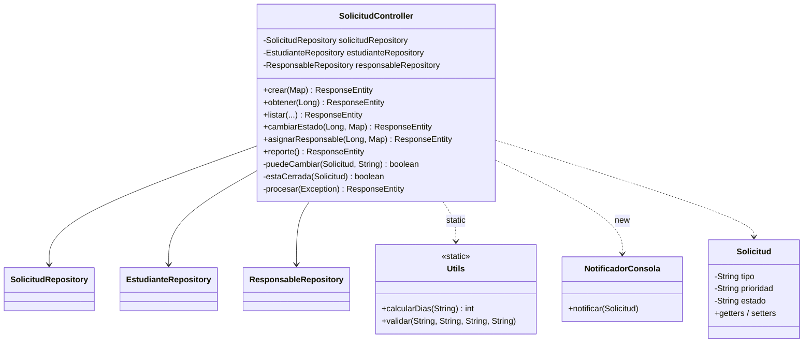
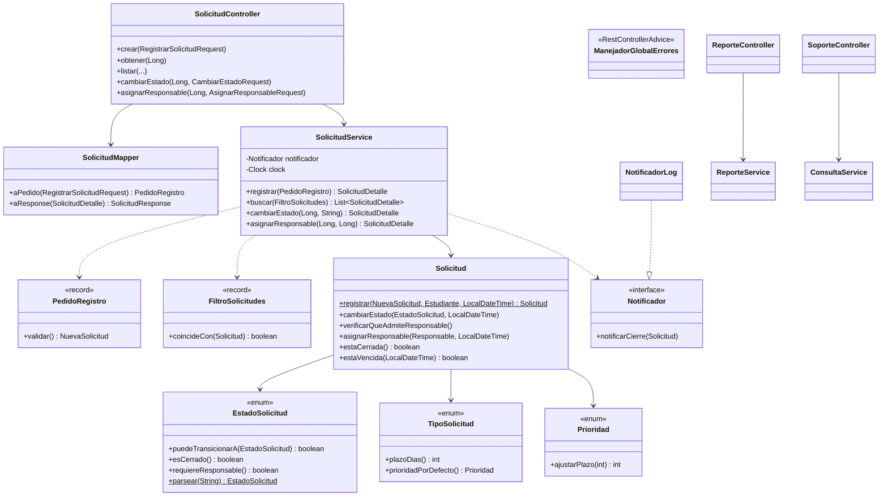

# 04 — SOLID y Clean Code: de la v1 a la v2

Este documento responde, por cada principio y cada práctica: **qué problema tenía la v1**, **cómo quedó la v2**, **qué refactoring o corrección lo resolvió** y **dónde se puede ver la evidencia**. Los rótulos S01–S12 son los smells de [`03-deuda-tecnica-code-smells.md`](03-deuda-tecnica-code-smells.md); R01–R09 son los refactorings de [`refactorings.md`](refactorings.md); O-1 a O-14 son las observaciones del code review ([`07-code-review-checklist.md`](07-code-review-checklist.md)). Las rutas son de `src/main/java/ar/edu/utn/tup/solicitudes/` salvo que se diga otra cosa.

## 1. Diagramas de clases

### 1.1 Antes (v1, tag `estado-inicial`)

Un controller que concentra todo, entidades anémicas con `String` y utilidades estáticas.

### 1.2 Después (v2, `main`)

Capas con dependencias hacia adentro, reglas en el dominio y dependencias de infraestructura detrás de interfaces.

## 2. Principios SOLID

### SRP — Responsabilidad única

| | |
|---|---|
| **Problema en v1** | `SolicitudController` (433 líneas) tenía **siete responsabilidades**: entrada, reglas, acceso a datos, armado de JSON, notificación, reporte y traducción de errores (S01). Cualquier cambio tocaba el mismo archivo. |
| **Mejora en v2** | Cada clase tiene un motivo para cambiar: `SolicitudController` recibe y delega; `SolicitudService` orquesta los casos de uso; `SolicitudMapper` traduce a DTO; `ReporteService` calcula el reporte; `ManejadorGlobalErrores` traduce excepciones a HTTP; `Solicitud` y los enums guardan las reglas propias. |
| **Refactoring / fix** | **R06** (Extract Class: `SolicitudService`, `ReporteService`, `SolicitudMapper`, `ReporteController`, y paquetes por capas); **O-4** (`ConsultaService`: `SoporteController` ya no accede a repositorios); **O-5** (la regla `vencida` se calcula en el service, no en el mapper). |
| **Evidencia** | `web/SolicitudController.java`, `aplicacion/SolicitudService.java`, `aplicacion/ReporteService.java`, `aplicacion/ConsultaService.java`, `web/SolicitudMapper.java`, `web/ManejadorGlobalErrores.java`; `docs/evidencias/despues/capturas/01-swagger-endpoints.png` (el reporte ya está en `reporte-controller`). Métrica: 433 → 100 líneas. |

### OCP — Abierto/cerrado

| | |
|---|---|
| **Problema en v1** | Agregar el tipo `BECA` exigía modificar **6 lugares en 2 archivos**, y 2 fallaban en silencio (plazo y prioridad equivocados), por los `switch` repetidos sobre `String` (S04, S07). |
| **Mejora en v2** | Un tipo nuevo es **una constante** en `TipoSolicitud` con su plazo y su prioridad por defecto. El service, el controller y el reporte (que recorre `values()`) no se tocan. Un canal de notificación nuevo es una implementación nueva de `Notificador`. |
| **Refactoring / fix** | **R02** (enums) y **R04** (comportamiento dentro de `TipoSolicitud`). |
| **Evidencia** | `dominio/TipoSolicitud.java`; `TipoSolicitudTest` (plazo y prioridad de cada tipo); [ADR-001](decisiones/ADR-001-enum-con-comportamiento.md); ejemplo de costo del cambio en `02-calidad-externa-interna.md` §3. |

### LSP — Sustitución de Liskov (grado acotado)

| | |
|---|---|
| **Problema en v1** | No había abstracciones que sustituir: `new NotificadorConsola()` estaba fijo dentro del controller. |
| **Mejora en v2** | Cualquier implementación de `Notificador` puede reemplazar a otra sin que `SolicitudService` lo note. En producción se usa `NotificadorLog`; en los tests, un `NotificadorFake` que acumula las solicitudes notificadas. |
| **Refactoring / fix** | **R08**. |
| **Evidencia** | `aplicacion/Notificador.java`, `aplicacion/NotificadorLog.java`; `NotificadorFake` en `src/test/.../aplicacion/SolicitudServiceTest.java`. |
| **Honestidad** | Hay una sola interfaz y dos implementaciones; el principio se cumple pero tiene poca superficie para demostrarse. No se afirma más que eso. |

### ISP — Segregación de interfaces (grado acotado)

| | |
|---|---|
| **Problema en v1** | No había interfaces propias; los controllers dependían de tres repositorios completos y de utilidades estáticas. |
| **Mejora en v2** | `Notificador` tiene **un solo método** (`notificarCierre`); cada controller depende solo del service que usa. |
| **Refactoring / fix** | **R08**, **R06**. |
| **Evidencia** | `aplicacion/Notificador.java`. |
| **Honestidad** | No hay interfaces "gordas" que dividir; ISP se cumple por construcción más que por una decisión activa. |

### DIP — Inversión de dependencias

| | |
|---|---|
| **Problema en v1** | `new NotificadorConsola()` (con `System.out.println`) y `LocalDateTime.now()` dentro del controller, `Utils` estático, `@Autowired` en campos y `@Transactional` en el controller (S11). La notificación y el reloj no se podían sustituir, y no se podía probar la lógica sin Spring. |
| **Mejora en v2** | `SolicitudService` depende de la **abstracción** `Notificador` y de `Clock`, ambos inyectados **por constructor**. `ClockConfig` aporta el `Clock`. |
| **Refactoring / fix** | **R08** (Introduce Interface + Dependency Injection); **O-5** (una sola hora de referencia por operación). |
| **Evidencia** | `aplicacion/Notificador.java`, `aplicacion/NotificadorLog.java`, `config/ClockConfig.java`; `SolicitudServiceTest` (construido sin Spring, con `Clock.fixed` y `NotificadorFake`). `grep` de `@Autowired` y `LocalDateTime.now()` sin reloj en `src/main`: 0. |

### Grado de aplicación (de `docs/04-diseno.md` §5)

| Principio | Aplicación en v2 | Grado |
|---|---|---|
| **SRP** | Controller (HTTP), Service (casos de uso), Mapper (traducción), `Solicitud` (reglas propias), `ManejadorGlobalErrores` (errores). | Fuerte |
| **OCP** | Nuevo tipo de solicitud = nueva constante en `TipoSolicitud` con su plazo y prioridad; no se tocan service ni controller. Nuevo canal de notificación = nueva implementación de `Notificador`. | Fuerte |
| **LSP** | Cualquier implementación de `Notificador` (`NotificadorLog`, o un `NotificadorFake` en los tests) se puede sustituir sin romper `SolicitudService`. | Acotado |
| **ISP** | `Notificador` tiene un solo método; los controllers dependen solo del service que usan. No hay interfaces "gordas" que dividir. | Acotado |
| **DIP** | `SolicitudService` depende de `Notificador` (abstracción) y de `Clock`, no de `System.out` ni de `LocalDateTime.now()`. | Fuerte |

## 3. Clean Code

### Nombres que revelan la intención

| | |
|---|---|
| **Problema en v1** | Variables `s`, `e`, `est`, `aux`, `lista2`, `res`, `dato`; método `procesar`; números `10`, `500`, `2`, `15` sin nombre (S09). PMD: 28 `ShortVariable`. |
| **Mejora en v2** | Nombres de dominio (`solicitud`, `estudiante`, `coincidentes`, `nuevoEstado`) y constantes con nombre: `LONGITUD_MINIMA_DESCRIPCION`, `LONGITUD_MAXIMA_DESCRIPCION`, `DIVISOR_PLAZO_ALTA`, `PLAZO_MINIMO_DIAS`. |
| **Refactoring / fix** | **R09**. |
| **Evidencia** | `aplicacion/PedidoRegistro.java`, `dominio/Prioridad.java`. PMD `ShortVariable`: 28 → 9, todas `id` (nombre exigido por JPA y por el contrato JSON). `AvoidLiteralsInIfCondition`: 1 → 0. |

### Funciones chicas, un nivel de abstracción

| | |
|---|---|
| **Problema en v1** | `crear` de 77 líneas, `listar` de 64, `reporte` de 43; NPath de hasta 41.515 y complejidad ciclomática de hasta 32 (S02). |
| **Mejora en v2** | Los métodos hacen una cosa; el más largo de `src/main` tiene 15 líneas (firma y llaves incluidas). |
| **Refactoring / fix** | **R01** (Extract Method), luego **R06**. |
| **Evidencia** | `docs/tpi/refactorings.md` (ficha R01); PMD: `CyclomaticComplexity`, `NcssCount`, `CognitiveComplexity` y `NPathComplexity` pasan de 17 violaciones a 0. |

### Sin duplicación

| | |
|---|---|
| **Problema en v1** | El bloque de mapeo a JSON copiado 5 veces y la condición "cerrada" copiada 7 veces (S03). |
| **Mejora en v2** | Un único `SolicitudMapper.aResponse` y un único `EstadoSolicitud.esCerrado()`. |
| **Refactoring / fix** | **R01**, **R03**, **R06**, **R05-B**. |
| **Evidencia** | `web/SolicitudMapper.java`, `dominio/EstadoSolicitud.java`. |

### Pocos parámetros y contratos tipados

| | |
|---|---|
| **Problema en v1** | `armarSolicitud` con 7 parámetros; filtros sueltos; `Map<String, Object>` como cuerpo y como respuesta (S05). El "Example Value" de Swagger salía `{}`. |
| **Mejora en v2** | Parameter Objects (`PedidoRegistro`/`NuevaSolicitud`, `FiltroSolicitudes`) y records de request/response. PMD `ExcessiveParameterList`: 1 → 0. |
| **Refactoring / fix** | **R05** (A: entradas; B: respuestas); **O-10** (fechas y errores documentados en OpenAPI). |
| **Evidencia** | `aplicacion/FiltroSolicitudes.java`, `web/dto/`; `docs/evidencias/antes/capturas/06-example-value-vacio.png` y `despues/capturas/06-example-value-tipado.png`. |
| **Límite** | El borde HTTP de `listar` conserva 4 `@RequestParam`: son el contrato (O-12, rechazada). El criterio de ≤3 parámetros se aplica a métodos de dominio y aplicación. |

### Manejo de errores

| | |
|---|---|
| **Problema en v1** | `catch (Exception)` en cada endpoint, código HTTP escrito dentro del texto (`"404|..."`) y cuerpo en texto plano (S10). PMD: 6 `AvoidCatchingGenericException`. |
| **Mejora en v2** | Excepciones propias (400, 404, 409) y un único `@RestControllerAdvice`; los errores inesperados responden 500 genérico sin detalles internos; mensajes de framework en español. |
| **Refactoring / fix** | **R07**; **O-9**. |
| **Evidencia** | `dominio/excepciones/` (3 clases), `web/ManejadorGlobalErrores.java`, `ManejadorGlobalErroresTest`; `despues/capturas/03-error-409-json.png`; [ADR-003](decisiones/ADR-003-cuerpo-de-error-json.md). |

### Cohesión

| | |
|---|---|
| **Problema en v1** | La regla de transiciones (`puedeCambiar`) vivía en el controller y solo usaba datos de la solicitud (Feature Envy, S06); la entidad era un contenedor de getters y setters (S08). |
| **Mejora en v2** | La regla está en `EstadoSolicitud.puedeTransicionarA`; `Solicitud` protege sus invariantes (`cambiarEstado`, `asignarResponsable`, `verificarQueAdmiteResponsable`) y se crea con la fábrica `Solicitud.registrar`, sin setters públicos. |
| **Refactoring / fix** | **R03** (Move Method); **O-1** (las reglas de asignación pasan al dominio); **O-6** (fábrica y sin setters). |
| **Evidencia** | `dominio/Solicitud.java`, `dominio/EstadoSolicitud.java`; `EstadoSolicitudTest` (25 transiciones), `SolicitudTest`. |

### Acoplamiento

| | |
|---|---|
| **Problema en v1** | Dependencias creadas con `new`, estáticas y ocultas (reloj, notificador, `Utils`); `@Transactional` en el controller (S11). |
| **Mejora en v2** | Inyección por constructor; transacciones en el service (`readOnly = true` en las consultas); sin utilidades estáticas ni paquete `util/`. |
| **Refactoring / fix** | **R08**; **O-8** (transacciones de solo lectura). |
| **Evidencia** | `aplicacion/SolicitudService.java`, `config/ClockConfig.java`. |

### Límites entre componentes

| | |
|---|---|
| **Problema en v1** | Un solo paquete funcional mezclaba HTTP, reglas y persistencia; la respuesta se armaba con tipos genéricos. |
| **Mejora en v2** | Paquetes por capa (`dominio`, `aplicacion`, `persistencia`, `web`, `config`); el dominio no conoce a la web; la validación de entrada vive en un único punto (`PedidoRegistro.validar()` y los métodos `parsear` de los enums); `open-in-view=false` con consultas que cargan lo necesario. |
| **Refactoring / fix** | **R06-B**; **O-2** (único punto de validación); **O-7** y [ADR-006](decisiones/ADR-006-entitygraph-y-tests-no-transaccionales.md) (`@EntityGraph` y test no transaccional); **O-3** y [ADR-005](decisiones/ADR-005-validacion-manual.md). |
| **Evidencia** | Estructura de `src/main/java`; `persistencia/SolicitudRepository.java`; `IntegracionHttpNoTransaccionalTest`. |

### Sin código muerto ni ruido

| | |
|---|---|
| **Problema en v1** | Bloque comentado del cálculo viejo y `System.out.println("DEBUG ...")` (S12); una dependencia declarada sin uso. |
| **Mejora en v2** | `grep` de `System.out` y de bloques comentados en `src/main`: 0; `spring-boot-starter-validation` eliminado. |
| **Refactoring / fix** | **R09**; **O-3**; **O-14** (metadatos del `pom.xml`). |
| **Evidencia** | PMD `SystemPrintln`: 3 → 0; `pom.xml`. |

## 4. Qué no resuelve este refactoring (límites honestos)

- **LSP e ISP** se cumplen, pero con poca superficie: una interfaz de un método. No se inventaron abstracciones para "mostrar" más SOLID.
- **`GodClass` de PMD** nunca disparó, ni antes ni después (TCC apenas por encima del umbral): el diagnóstico de S01 se apoyó en métricas de tamaño y complejidad y en el conteo de responsabilidades, no en esa regla.
- **Seis de los doce smells** (S03, S04, S06, S07, S08, S11) no los detecta ninguna regla de PMD configurada; se identificaron leyendo el diseño.
- **9 violaciones PMD** (`ShortVariable` sobre `id`) se dejaron a propósito.
